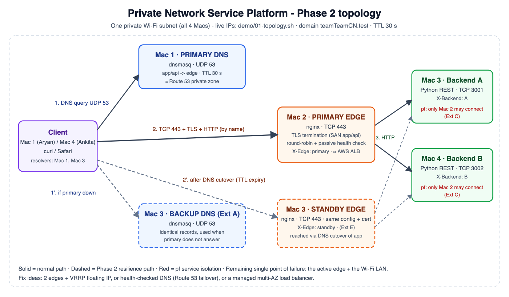
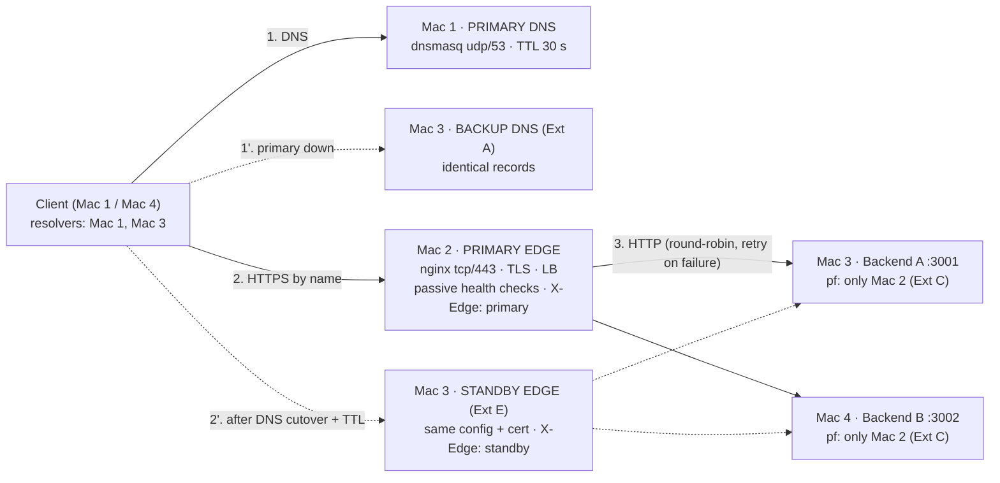
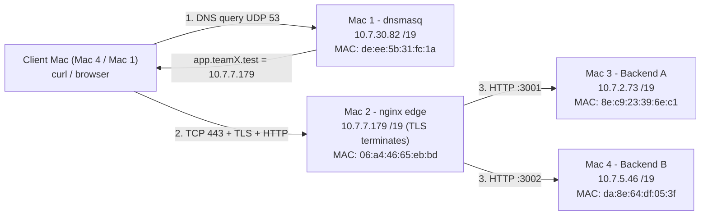

# Architecture (Phase 2: Harden & Recover; extends Phase 1)



Live IPs: [ip-service-inventory.md](ip-service-inventory.md) (generated from `env.sh`, because DHCP changes IPs day to day).



## What each Phase 2 component adds

| Extension | Component | Mechanism | Failure it handles | Cloud equivalent |
|---|---|---|---|---|
| A | backup dnsmasq on Mac 3 | client resolver list `Mac1 Mac3`; resolver moves on when the first is silent or unreachable | DNS server down | Route 53's multiple name servers / secondary DNS |
| B | `local-ttl=30` on `host-record`s | caches may reuse an answer for 30 s | controls how fast record changes spread | Route 53 record TTL |
| C | pf anchor `com.apple/250.CNIsolation` on Mac 3/4 | `pass` from Mac 2, `block drop` for the rest, `keep state` | bypassing the edge / exposing backends | security groups (backend SG allows only the ALB SG) |
| D | nginx `max_fails=1 fail_timeout=10s`, `proxy_next_upstream`, `proxy_connect_timeout 1s` | passive health check + same-request retry | backend down | ALB target-group health checks |
| E | standby nginx on Mac 3 + `dns-set-app.sh standby` | DNS cutover; same cert (bound to the name) | planned edge migration / edge loss | Route 53 failover routing, blue/green edge |
| F | `diagnose.sh`, `diagnose-edge.sh` | bottom-up layer checks, degraded-pool detection | any injected fault | runbooks / observability |

## Request paths
- **Normal:** client → Mac 1 DNS (A = Mac 2) → TCP 443 + TLS to Mac 2 → round-robin HTTP to A:3001 / B:3002.
- **Primary DNS down:** client → Mac 1 (no answer) → Mac 3 DNS (same answer) → normal path continues.
- **Backend down:** Mac 2 tries A → connect fails within 1 s → the same request goes to B → client gets 200. A is skipped for 10 s.
- **Edge cutover:** `app` → Mac 3. Clients with a cached answer keep using Mac 2 until their TTL expires, then do a fresh TCP + TLS handshake to Mac 3.

## Remaining single points of failure
The **active edge** (one nginx serves all traffic at a time), the **Wi-Fi LAN/AP**, and **Mac 2 as the only CA key holder**. Eliminating the edge SPOF would take two edges with a floating VIP (VRRP/keepalived, about 1 s, same L2 only), health-checked DNS failover (cross-network, TTL-bound), or a managed multi-AZ load balancer.

## Phase 2 design decisions
- Backup DNS and standby edge both run on **Mac 3**: the PDF names Mac 1/Mac 4 as clients, the backup resolver must not be Mac 1, and Mac 3 is administered over SSH.
- `host-record` rather than `address=`: exact names, and AAAA queries get a clean no-data answer instead of NXDOMAIN.
- Clients list **only team resolvers**. A public resolver answers NXDOMAIN for `.test`, and macOS caches it (we observed this).
- Upstream for internet names: 8.8.8.8 with the campus resolver as fallback. Our zone is never forwarded (`local=/teamTeamCN.test/`).
- `block drop` rather than `block return`: an unauthorised client gets a timeout and learns nothing about the service.

---

# Phase 1 architecture (as reviewed; IPs from the Phase 1 review day)

## Topology (one L2/L3 segment: campus Wi-Fi 10.7.0.0/19, mask 255.255.224.0, gateway 10.7.0.1)

```
 Client --DNS(UDP53)--> Mac1 dnsmasq (10.7.30.82)         (answer: Mac2 IP 10.7.7.179)
 Client --TCP+TLS+HTTP(443)--> Mac2 nginx (10.7.7.179) --HTTP:3001--> Mac3 Backend A (10.7.2.73)
                                                       \--HTTP:3002--> Mac4 Backend B (10.7.5.46)
 Subnet: 10.7.0.0/19 | Netmask: 255.255.224.0 (0xffffe000) | Gateway: 10.7.0.1 | Broadcast: 10.7.31.255
```
All four Macs sit on the same Wi-Fi subnet; the diagram above is the logical service topology.

## Machine roles & Real Network Identifiers
| Mac | Person | Hostname | Role | IPv4 | Netmask (/Prefix) | Gateway | MAC (on the air) | MAC (hardware) | Cloud equivalent |
|---|---|---|---|---|---|---|---|---|---|
| 1 | Aryan | `MacBook-Pro-88` | Private DNS + test client | 10.7.30.82 | 255.255.224.0 (`/19`) | 10.7.0.1 | `de:ee:5b:31:fc:1a` | `10:9f:41:be:57:6d` | Route 53 (private hosted zone) |
| 2 | Ranajeet | `Ranajeets-MacBook-Pro` | Edge: TLS termination, reverse proxy, load balancer | 10.7.7.179 | 255.255.224.0 (`/19`) | 10.7.0.1 | `06:a4:46:65:eb:bd` | `10:9f:41:bb:a2:9f` | AWS ALB / CloudFront edge |
| 3 | Abhijeet | `Abhijeets-MacBook-Pro-3` | Backend A | 10.7.2.73 | 255.255.224.0 (`/19`) | 10.7.0.1 | `8e:c9:23:39:6e:c1` | `10:9f:41:c0:b2:b1` | App server instance A (EC2/ECS task) |
| 4 | Ankita | `Ankitas-MacBook-Pro` | Backend B + client | 10.7.5.46 | 255.255.224.0 (`/19`) | 10.7.0.1 | `da:8e:64:df:05:3f` | `10:9f:41:c6:2a:38` | App server instance B |

## Request flow
1. Client asks Mac 1: `A? app.teamX.test` (UDP 53) -> answer `10.7.7.179`. DNS only finds the IP.
2. Client opens TCP to 10.7.7.179:443 (SYN, SYN-ACK, ACK) - separate from DNS.
3. TLS handshake with nginx (SNI app.teamX.test, certificate with SAN, key exchange, Finished). TLS ends at nginx.
4. Client sends the HTTP request (encrypted on the wire). nginx picks the next upstream (round-robin), opens a new TCP connection to Mac 3:3001 or Mac 4:3002 (plain HTTP inside the LAN).
5. Backend answers JSON + `X-Backend`; nginx relays it back over the TLS session. Cache headers pass through unchanged.

## Protocol / layer mapping
| Item | OSI | TCP/IP | Details / Ports / Addresses |
|---|---|---|---|
| HTTP/1.1 REST, DNS | 7 Application | Application | JSON payloads, ETag caching, UDP 53 DNS queries |
| TLS 1.2 / 1.3 | 6/5 (presentation/session) | Application (over TCP) | TCP 443; terminated on Mac 2 (`edge.pem`) |
| TCP / UDP | 4 Transport | Transport | TCP 443 (edge), TCP 3001/3002 (backends), UDP 53 (DNS) |
| IPv4 | 3 Network | Internet | Subnet **10.7.0.0/19**, Mask **255.255.224.0** (`0xffffe000`), Gateway **10.7.0.1** |
| Data Link (MAC) | 2 Data link | Link | 802.11 Wi-Fi frames with on-air MACs (`de:ee:..`, `06:a4:..`, `8e:c9:..`, `da:8e:..`) |
| Physical | 1 Physical | Link | Wi-Fi 2.4 GHz / 5 GHz RF channel |

## Why clients never use backend IPs
Clients know only a name. DNS maps the name to the edge. The edge hides, scales and replaces backends (add/remove/failover) with zero client change, centralises TLS, and is the only thing exposed (smaller attack surface). Same idea as DNS -> load balancer -> target group in the cloud.

## Key design decisions
- Subnet: `10.7.0.0/19` with netmask `255.255.224.0` (all 4 Macs reside on the same broadcast domain).
- `.test` (RFC 6761 reserved), not `.local` (mDNS conflict on macOS).
- nginx default round-robin over `upstream app_pool`; passive failover (`max_fails`, `proxy_next_upstream`).
- TLS: mkcert local CA (faculty-approved), leaf SAN = app.teamX.test + api.teamX.test, CA trusted in the System keychain on every Mac.
- Backends bind 0.0.0.0 (LAN reachable), fixed ports 3001/3002.
- Caching: `/api/cache` -> `Cache-Control: max-age=60` + `ETag: "phase1-cache-v1"`; matching `If-None-Match` -> 304.
